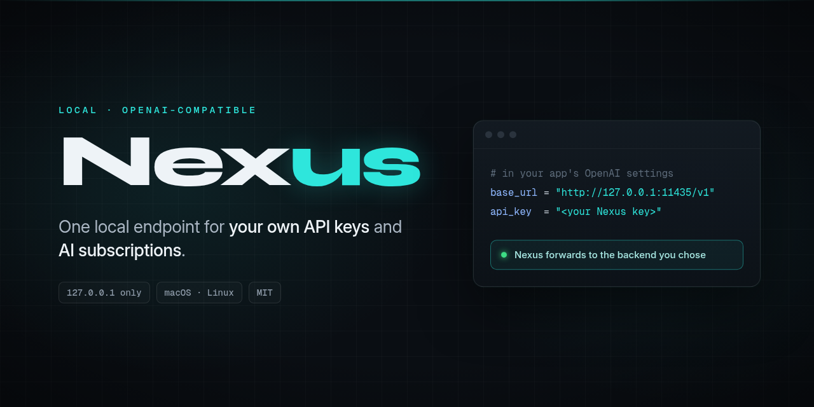
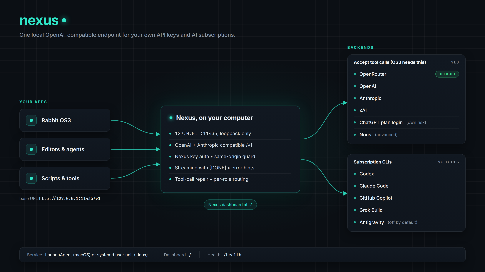

# Nexus



**One local OpenAI-compatible endpoint on `127.0.0.1` for your own API keys and AI subscriptions.**

[](LICENSE)
[](pyproject.toml)

Created by olympusbuildz.

Nexus is built for Rabbit OS3 (OS3 Local) and works with any app that lets you set a custom OpenAI base URL. Apps call `http://127.0.0.1:11435/v1`, and Nexus forwards each call to the backend you chose.

> **Read this before you connect a subscription.** Nexus uses your own logins and API keys. Using a consumer subscription this way may break that provider's terms, and the provider could limit or suspend your account. Your prompts still go to the provider you pick; only the endpoint is local.



## Quickstart

```bash
git clone https://github.com/olympusbuildz/nexus.git
cd nexus
./install.sh
```

Check [Requirements](#requirements) first. The installer asks which backend to use. Press Return, or type `1`, for OpenRouter, then paste your key. The terminal shows nothing while you paste. It then starts Nexus and runs `./nexus test`. It is safe to run again, and it never uses `sudo`. On Linux with no systemd user session (a container, or plain SSH), starting the service stops with a message and installs nothing. Run `./nexus run` in one terminal, and `./nexus test` in another.

No terminal to ask in (a script, CI, a remote shell)? The installer stops after the install and prints the next step. The same thing by hand, with the key on stdin so it stays out of the output:

```bash
printf '%s\n' "$OPENROUTER_API_KEY" | ./nexus setup --backend openrouter --api-key-stdin --non-interactive
./nexus start && ./nexus test --wait 20
```

Port 11435 taken, or a second copy wanted? Set `NEXUS_PORT` (for example `export NEXUS_PORT=11437`) in the shell before `./install.sh`, `./nexus start`, `./nexus run`, `./nexus test` and `./doctor.sh`, then use that port in the base URL you give your app. Nexus still listens on `127.0.0.1` only. Details: [docs/service.md](docs/service.md#another-port-or-a-second-checkout).

**Status.** Pre-1.0 (0.7.2). Every backend has automated tests against mocked upstreams or fake CLI binaries. The `chatgpt` backend has been proven end to end with Rabbit OS3 (Cipher) on a live install: a tool-using weather task succeeded on 2026-10-19. No other backend has been run end to end with OS3, and the free OpenRouter default model is still unverified with OS3. Experimental: the plan CLIs, `nous` and `./nexus rabbit`.

## Other things to know

- **Rabbit OS3 needs tool calls.** Only API-key backends and the `chatgpt` backend accept them. The plan CLIs refuse them, so they do not work with OS3. See [the table](#provider-risk-and-backend-choice).
- **An exported provider key beats the key file, silently.** If `OPENROUTER_API_KEY`, `OPENAI_API_KEY`, `ANTHROPIC_API_KEY`, `XAI_API_KEY` or `NOUS_API_KEY` is set in the shell that starts `./nexus run`, Nexus uses it instead of the key `./nexus setup` saved, and nothing says so. A wrong exported key then shows up as `401` even though setup accepted a good one. Check `curl -s http://127.0.0.1:11435/health | jq '.backends.openrouter.key_source'` (use your backend's name): `"env"` means the variable is in use, `"file"` means the key file. Run `unset OPENROUTER_API_KEY` (or the matching name) to go back to the file. The packaged service (`./nexus start`) does not inherit your shell, so it reads the key file only.
- **Rabbit stores your settings.** OS3 saves the connection you give it, including the Nexus key, on Rabbit's servers.
- **Network.** Nexus has no analytics and never updates itself. It contacts the provider you configure. With the `chatgpt` backend it also contacts `chatgpt.com` and `auth.openai.com`. It contacts Rabbit's site only while you run `./nexus rabbit`.
- **Local only.** Nexus listens on `127.0.0.1` only. It keeps keys in files that only your user can read.

## Requirements

- A Mac or a Linux computer. OS3 Local, which runs through Rabbit's `rabbit-agent`, must be on the same computer as Nexus.
- Terminal. On a Mac, press Command-Space, type Terminal and press Return.
- Python 3.11 or newer, and git. On a Mac, install [Homebrew](https://brew.sh), then run `brew install python git`. On Debian or Ubuntu, run `sudo apt install python3 python3-venv git`.
- To keep Nexus running in the background: macOS (launchd), or Linux with a systemd user session. Over plain SSH, in a container, or on a host without `systemctl`, `./nexus start` stops with a message and installs nothing. Run `./nexus run` in a terminal there instead; everything else works the same.
- A key from one provider. The easiest is an [OpenRouter](https://openrouter.ai/keys) key: create an account, then create a key on the Keys page.

## Connect Rabbit OS3

1. Optional: open `http://127.0.0.1:11435/` in your browser to check the backend shows Ready. The full dashboard that `./install.sh` builds has no copy button; only the simpler built-in page (when Node is missing or `NEXUS_SKIP_UI=1`) has a **Connect your app** card with copy buttons.
2. In OS3, open Settings, then API keys ([os3.rabbit.tech/settings/api-keys](https://os3.rabbit.tech/settings/api-keys)), and add a Local connection. OS3 Local calls Nexus from your own computer, so `127.0.0.1` means your computer.
3. Enter three values:
   - **Base URL:** `http://127.0.0.1:11435/v1` (the port in `NEXUS_PORT`, if you set one)
   - **Key:** the single line in `.nexus_api_key` in the `nexus` folder. Run `cat .nexus_api_key` and copy the line (macOS: `pbcopy < .nexus_api_key`; Linux with xclip: `xclip -selection clipboard < .nexus_api_key`). If you see a **Copy key** button on the dashboard, it does the same.
   - **Model:** an ID your backend serves. `./nexus test` prints the one Nexus will use. On OpenRouter it is `google/gemma-4-31b-it:free` unless you chose another, such as `openai/gpt-4o-mini`. If OS3 asks for a context window, enter 65536, the value Nexus's own Rabbit setup uses.
4. Start an OS3 task.

Rabbit's screens are not part of this repository, so their labels may differ from the ones above. The model ID must be one your backend can serve.

Nothing in this repository tests the free default model against OS3, so whether it handles OS3's tool calls is unverified. If tasks fail, pick a stronger model in the dashboard. Nexus can also enter the values in OS3 for you, but that uses Rabbit's undocumented API and is optional: see [docs/rabbit-setup.md](docs/rabbit-setup.md).

## Provider risk and backend choice

| Backend | Works with OS3 tool calls? | Terms risk | Cost |
| --- | --- | --- | --- |
| `openrouter` (default), `openai`, `xai` | Yes | Standard API terms | Billed to your key. The default model id ends in `:free` |
| `anthropic` | Yes | Standard API terms | Billed to your key |
| `chatgpt` (ChatGPT plan login) | Yes | Higher: not an official client or public API | Counts against your plan limits |
| `codex` | No | Moderate | Counts against your plan limits |
| `claude-code` | No | Moderate. We have not confirmed that serving other apps through Claude Code is permitted | Counts against your plan limits |
| `copilot` | No | Higher | Counts against your plan limits |
| `grok-build` | No | Not assessed; read xAI's terms | Counts against your plan limits |
| `antigravity` | No | Higher. Off unless you opt in | Counts against your plan limits |
| `nous` (advanced) | Yes | Standard API terms | Billed by Nous. Needs a Hermes Agent sign-in |

The ratings are our judgment, not legal advice. Each provider's terms are linked in [docs/backends.md](docs/backends.md#provider-risk), along with the default models and everything else about backends. To switch backend, run `./nexus setup`, then restart Nexus as described in [docs/service.md](docs/service.md#when-to-restart).

## What success looks like

`./nexus test` prints the base URL, the key file path, the backend and the model. It then checks `server`, `backend`, `/v1`, `chat` and `tool call`, and the last line should read `RESULT: PASS`. Each failing line is followed by a `fix:` line. The usual ones:

- `nothing is listening`: run `./nexus start`, then `./nexus test` again. If the port is busy, the output names what is using it.
- `backend is not ready`, or a missing key: run `./nexus setup`, then `./nexus stop` and `./nexus start`.
- `401`: the key was refused. Use the single line in the key file that `./nexus test` names.
- A model error: choose a model your account can use, in the dashboard.

If it still fails, run `./doctor.sh`, then open an issue. Do not paste keys, or screenshots that show them. A passing test shows that Nexus works. It does not show that your model handles OS3's tool calls.

## Uninstall

```bash
cd nexus   # your clone: the folder that holds install.sh. Use its real name if you renamed it; the curl installer uses ~/nexus
./nexus stop
./nexus status   # port 11435 should say "free"
cd .. && rm -rf nexus
```

Running `./nexus run` in a terminal? Press Ctrl-C there too, and only delete the folder once `./nexus status` shows the port free.

Then remove the files outside the folder:

- macOS: `~/Library/Application Support/Nexus` (provider keys, and the Chrome profile if you used `./nexus rabbit setup`).
- Linux: `~/.config/nexus` (or `$XDG_CONFIG_HOME/nexus`).
- Installed under the old os3-bridge names? The old folders are listed in [docs/upgrading-from-os3-bridge.md](docs/upgrading-from-os3-bridge.md).
- If you used the `chatgpt` backend: `~/.codex/auth.json.nexus.lock`. Leave `~/.codex/auth.json`; it belongs to the Codex CLI.
- Package caches, shared with your other tools and safe to leave: pip's download cache (`~/.cache/pip` on Linux, `~/Library/Caches/pip` on macOS) and, if the dashboard was built, npm's (`~/.npm`). `pip cache purge` and `npm cache clean --force` clear them.

Finally, delete or change the connection in OS3. Nexus makes no other changes: no `sudo`, no global packages, no shell profile edits.

## Links

- [CONNECT.md](CONNECT.md): wiring for OS3, Cursor, Claude Code, curl and the OpenAI SDK
- [docs/backends.md](docs/backends.md): backends, keys, health checks, limits
- [docs/service.md](docs/service.md): the background service, restarts, dashboard
- [docs/upgrading-from-os3-bridge.md](docs/upgrading-from-os3-bridge.md): installs made under the old names
- [docs/rabbit-setup.md](docs/rabbit-setup.md): optional automatic OS3 setup
- [SECURITY.md](SECURITY.md), [CHANGELOG.md](CHANGELOG.md), [CONTRIBUTING.md](CONTRIBUTING.md), [MIT license](LICENSE)
