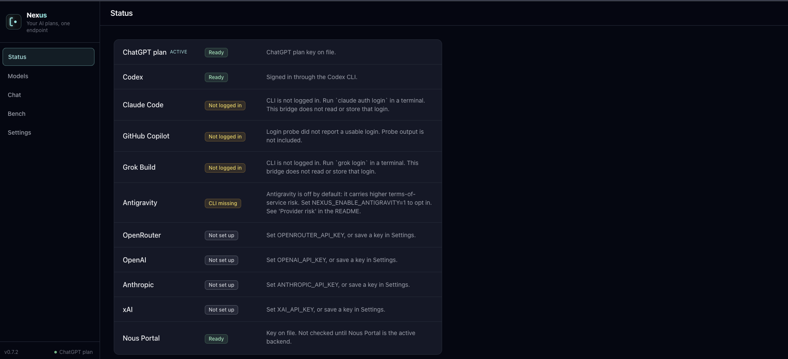

# Running Nexus

The background service and the dashboard. Installed under the old os3-bridge names? See [upgrading-from-os3-bridge.md](upgrading-from-os3-bridge.md).

`./nexus start` installs Nexus as a background service that starts at login: a LaunchAgent on macOS, a systemd user unit on Linux. Anywhere else, or when you want the output in your terminal, use `./nexus run`.

## Commands

| Command | What it does |
| --- | --- |
| `./install.sh` | Create `.venv`, choose a backend, start the service, run `./nexus test`. Safe to re-run |
| `./nexus setup` | Choose a backend, write key files with mode `600`, print the client settings |
| `./nexus start` | Install and start the service when port 11435 is free |
| `./nexus stop` | Unload the service and remove its unit file. Also ends a foreground `./nexus run` started from this checkout (SIGTERM). Any other listener stays up |
| `./nexus test` | Print the base URL, key file path, backend and model, then run a real chat and a tool-call round trip. PASS, FAIL or SKIP per step, with a fix line; non-zero exit on failure |
| `./nexus status` | Show paths, file modes and whether the service is loaded |
| `./nexus run` | Foreground process, after the same port check |
| `./nexus menubar` | Optional macOS status item |
| `./nexus rabbit plan\|setup\|restore\|verify` | Optional: change Rabbit OS3 settings for you. See [rabbit-setup.md](rabbit-setup.md) |
| `./doctor.sh` or `./nexus doctor` | Live readiness check, prints PASS or FAIL |

`./nexus test` skips the tool-call step on a subscription CLI backend, because those refuse tools. While Antigravity is the active backend and `NEXUS_ENABLE_ANTIGRAVITY=1` is not set, its backend, chat and tool-call steps are SKIP with that hint, not FAIL.

For a non-interactive setup, the line on stdin is the key. It is written to the key file and left out of the command's output:

```bash
printf '%s\n' "$OPENROUTER_API_KEY" | ./nexus setup --backend openrouter --api-key-stdin
```

`./install.sh` with no terminal to ask in stops after the install and prints the next commands. Run `./nexus setup --backend <id> --non-interactive` (it creates the Nexus key `.nexus_api_key`) before `./nexus start`. Writing only `.nexus_backend` skips the key, and `./nexus test` then fails with `missing_api_key`.

## What the service runs

The unit runs `<checkout>/.venv/bin/python -m os3_bridge.cli run`. That module is a compatibility shim over the `nexus` package. `run` checks `127.0.0.1:11435` before it binds:

- Port free: the process starts.
- Port taken: the command names the holder (pid, command, and whether it is this service, another Nexus checkout, or something else) with the safe next step, then exits and leaves that process running. `start` never signals anything. `./doctor.sh` prints the same detail. The LaunchAgent stays down after a clean exit, so a busy port does not restart in a loop. Run `./nexus start` again once the port is free.
- This service is already the listener: `start` leaves it running. `./nexus stop` then `./nexus start` reloads it.
- The port check itself fails: nothing is installed or stopped.

`./nexus stop` runs `launchctl bootout` or `systemctl --user disable --now` for this unit only, then removes the unit file. Key files stay. If a foreground `./nexus run` from this same checkout holds the port, `stop` sends it SIGTERM and says so. A process from another checkout, or that is not Nexus, is never signaled: `stop` names it and leaves it running.

On macOS the unit is `~/Library/LaunchAgents/ai.nexus.server.plist` and its logs are `os3-bridge.out.log` and `os3-bridge.err.log` in the checkout. On Linux the unit is `~/.config/systemd/user/nexus.service`. `start` needs a systemd user session: over plain SSH, in a container, or on a host without `systemctl` it stops with a message and installs nothing, so use `./nexus run` there. The Linux service starts for the current login; to start it at boot, run `loginctl enable-linger "$USER"` (optional).

## What the service receives

The service does not inherit your shell. `./nexus start` copies only these settings into the unit, from the shell that runs it:

- `NEXUS_HOST` and `NEXUS_PORT`
- `NEXUS_BACKEND`, set from the choice file (see below)
- `NEXUS_MODEL`, when set
- `NEXUS_SERVICE_LABEL`, when set
- `NEXUS_ENABLE_ANTIGRAVITY`, when on
- `NEXUS_RABBIT_WATCHDOG` and `NEXUS_RABBIT_AGENT_LABEL`, when set
- the `NEXUS_*_BIN` path of each subscription CLI it found

Everything else is ignored by the service, including provider API keys, `NEXUS_FALLBACK`, `NEXUS_MAX_INFLIGHT`, `NEXUS_TOOL_REPAIR`, `NEXUS_ENABLE_NOUS_IMAGES`, `NEXUS_IMAGES_BACKEND`, `NEXUS_HEALTH_TIMEOUT`, `NEXUS_MODEL_*` and `NEXUS_RABBIT_SETUP`. For the service, use the files Nexus reads on every request: the provider key files, `.nexus_fallback.json` and `.nexus_roles.json`. Settings that have no file, such as `NEXUS_MAX_INFLIGHT`, need `./nexus run` with the variable exported.

`./nexus start` passes the backend name from the choice file (`.nexus_backend`) to the service as `NEXUS_BACKEND`. A later Settings save writes that same file and the running Nexus uses it on the next request, so the environment value never hides the file, including after a relaunch. With no file, the environment value is used, and unset means OpenRouter. Deleting the choice file brings the environment value back.

## When to restart

- Backend chosen with `./nexus setup`, or saved on the dashboard: `./nexus stop` then `./nexus start` reloads the service. A backend saved on the dashboard also applies to the next request without a restart.
- `NEXUS_MODEL` or another variable in the list above: `./nexus stop` then `./nexus start`, with the variable exported in that shell. The environment model wins over the saved model file until that restart. A foreground process needs a restart for any environment change.
- The Nexus key file, or the provider key file of the active backend: no restart. The next request reads the file.

The dashboard cannot restart the process that serves it: stop would unload the unit before start could run. Run the commands from another terminal. On macOS, the menu bar item's **Restart door** runs the same two commands.

## Another port, or a second checkout

Set `NEXUS_PORT` (for example `NEXUS_PORT=11437`) before `./install.sh`, `./nexus start`, `./nexus run`, `./nexus test`, `./nexus status` or `./doctor.sh`, and use that port in your client's base URL. Nexus stays loopback-only. To run a second checkout as its own service on macOS, also set `NEXUS_SERVICE_LABEL` (for example `com.example.nexus-test`); the default label is `ai.nexus.server`. `./nexus setup` prints the base URL with the configured port, and `./nexus stop` waits until that label's process has exited.

Nexus binds `127.0.0.1` only, so put that address in client settings, not the name `localhost`. A foreground `python server.py` accepts `NEXUS_HOST=localhost` and rewrites it to `127.0.0.1`.

## Menu bar (macOS, optional)

`./nexus menubar` shows `nexus ●` when Nexus answers `/health` and `nexus ○` when it does not, and offers **Restart door**. Nexus does not depend on it: the menu bar is a separate process, only the `menubar` subcommand imports it, and `start` and `run` behave the same with or without it installed. Restart runs `./nexus stop` then `./nexus start`, the same stop, start and port check the CLI performs, on the same label. A failed stop skips the start rather than leaving Nexus unloaded.

Unloading and loading a LaunchAgent are not synchronous, so a restart waits for the old process to stop answering before it starts, then waits for the new one to answer before it reports. It waits at most 10 seconds for the stop and 20 for the start, and reports the real state either way.

It needs pyobjc, an optional extra that is not in `requirements.txt`:

```bash
make menubar-install
./nexus menubar            # --interval seconds, default 5
```

`NEXUS_MENUBAR_INTERVAL` sets the default when the flag is absent. Status is up or down only: `/health` `ok: true` means the process answered, not that the backend is `ready`. The poll sends no key, because `/health` needs none. The app draws only its own status item, so it needs no Accessibility or Screen Recording permission.

## Dashboard



`http://127.0.0.1:11435/` shows the active backend and a verdict (Ready, Unconfirmed, Not ready, Degraded or Down), lets you pick a backend and model and paste a provider key, and lists the last 40 `/v1` calls. A model saved there is written to `.nexus_model`. Which routes it uses, and why they need no token, is in [SECURITY.md](../SECURITY.md#routes). The JSON behind it is in [ui-api.md](ui-api.md).

Two pages can answer on `/`. A built React UI in `ui/dist` (or `NEXUS_UI_DIST`) is served when it exists. `./install.sh` builds it when the Node major in `ui/.nvmrc` or newer and `npm` are on `PATH`; `NEXUS_SKIP_UI=1` skips the build, and `cd ui && npm ci && npm run build` builds it later. Without a build, the built-in page is served. Only the built-in page has the **Connect your app** card with **Copy** and **Copy key** buttons; the React UI has no copy-key button.

The pulse and traffic totals are in memory and count calls through Nexus, not your plan balance with Claude, ChatGPT or Grok. Headers, bodies and keys are not stored. Usage counts are kept in `.nexus_usage.json`.
